<picture>
  <source media="(prefers-color-scheme: dark)" srcset="assets/banner-dark.svg">
  
</picture>

  <b>BSc Computer Science, Brunel University London</b> · graduating 2028 
  Software engineer on a year-long placement at <b>Accenture</b>, London 
  <b>Looking for graduate software engineering roles from 2028</b>

  
  

I like the part of software most people skip: tests, tooling, and the question **"how do we actually know this
works?"** With AI writing more and more code, I build the checks that keep it honest.

 

### Currently building

<picture>
  <source media="(prefers-color-scheme: dark)" srcset="assets/tracefix-logo-reversed.svg">
  
</picture>

**Tracefix checks whether a bug fix really fixes the bug, then tries to break it.**

Give it a fix, written by a coding agent or a person, and it produces a **Fix Receipt**: evidence from real test
runs that the bug existed, that the fix removes it and that the tests guard it. Then **Break My Fix** throws
generated inputs at the fixed code and reports the one that still breaks it, or exactly how many it tried.

<picture>
  <source media="(prefers-color-scheme: dark)" srcset="assets/receipt-dark.svg">
  
</picture>

- **AI proposes, code decides.** Models write tests and suggest attacks. Every pass or fail comes from code that
  actually ran, never from a model's opinion.
- **Attacks, not just checks.** Hundreds of generated inputs hunt for one that still breaks the fix
  (property-based testing with Hypothesis), and mutation testing checks that the tests really guard it.
- **Works where developers work.** A command-line tool, plus a GitHub Action that posts the receipt on the pull
  request.

<b>Technical details</b>

 

- **Untrusted code, contained.** Generated tests run in throwaway copies, sandboxed with bubblewrap on Linux, with
  whole-process-tree kills and tamper detection around every run.
- **Before and after.** The same generated inputs run on the old and the fixed code; every change in behaviour is
  listed and labelled as intended or not.
- **Benchmarked on real fixes.** 200+ runs against real-world bug fixes, including patches written by AI coding
  agents. The release gates are still open, which is why it isn't public yet.
- **Engineering.** Python with `mypy --strict`, 1,600+ tests, CI on Linux and Windows.

In active development. Private until it passes its own release gates.

 

### Toolbox

  
  
  
  
  
  
  
  
  
  

